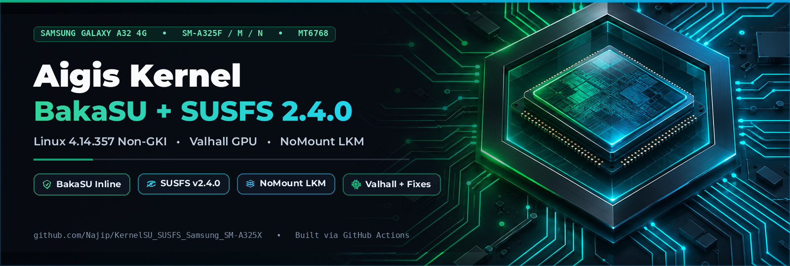

# KernelSU_SUSFS_Samsung_SM-A325X

Android kernel for Samsung Galaxy A32 4G (SM-A325x series, codename `a32`, MediaTek MT6768): the **Aigis** kernel by SlamZDank in two root flavors, [BakaSU](https://github.com/Baka-SU/BakaSU) or [xxKSU](https://github.com/Najip/xxKSU) by backslashxx (both KernelSU forks for non-GKI kernels), with SUSFS by simonpunk ported to non-GKI by JackA1ltman, and NoMount. Tested only on: SM-A325F on LumiROM 9 (Android 17).

XDA thread: [[KERNEL][A325F/M/N][STABLE] KernelSU (BakaSU / xxKSU) + SUSFS 2.4.0 + NoMount](https://xdaforums.com/t/kernel-a325f-m-n-stable-kernelsu-bakasu-v4-2-0-rc3-xxksu-v3-3-1-mojito-susfs-v2-4-0-nomount-v2-3-1.4809753/)

This repo stores no kernel source. The GitHub Actions workflows download every source fresh, patch it and build a flashable ZIP.

## What the kernel gets

- Two root flavors, one kernel ZIP each. Flash one of them and install its manager app; both managers are in every release:
  - **BakaSU**, from its `main` branch, with its SUSFS inline hooks (calls compiled into the kernel, the fastest style that works with SUSFS). The manager is the BakaSU build of the same BakaSU commit.
  - **xxKSU** by backslashxx, from the `sync-mojito` branch of [Najip/xxKSU](https://github.com/Najip/xxKSU), with manual hooks next to the SUSFS hooks. The manager comes from the matching Najip/xxKSU release.
- SUSFS v2.4.0: the core files (`fs/susfs.c`, `susfs.h`, `susfs_def.h`) come from JackA1ltman's patch. All features on: sus path, sus mount, sus kstat, spoof uname, spoof cmdline, open redirect, sus map, priority UID filter, hide symbols, logging.
- Upstream NoMount, built for this exact kernel. The kernel ZIP carries it and installs or replaces it when you flash; it is also released as a separate ZIP. Or built into the kernel with the `integrate` option.
- Valhall GPU with Aigis' drivers module (default), or the stock A32 GPU. Aigis' own CPU/GPU tuning.
- Network fix by Juan (LumiROM): UDP-only GSO for IPv4 and IPv6, ticked by default. No LTO.
- Flashlight fixes by aartzz: the torch no longer turns itself off after the flash timeout, and the camera's flash fault check gets an answer (no more "No such command" log spam). Always on.
- JPEG + BBR fix: every kernel ZIP installs the small root module `a32-jpeg-bbr`. It fixes blank JPEG photos in Telegram and other apps on One UI 9 ports by letting apps use the kernel's `mtk_mm` memory heap, and keeps TCP on BBR (the vendor switches it to bic). It skips what the ROM already fixes and removes itself once the ROM has both. Based on Juan's (LumiROM) fix.
- Built by `Najip@github`: shown in `/proc/version`, `uname -a` and About phone. The **uname tag** (default `-forkby-gh.Najip`) is added to `uname -r`.

Details: [Kernel details](docs/kernels.md).

## Why there are two root flavors

This kernel started with xxKSU. On 2026-11-23 it moved to BakaSU only, and xxKSU was dropped after backslashxx's `backslashxx/KernelSU` repository was taken down. That was too quick: backslashxx kept improving xxKSU's kernel side inside the [ximi-mojito kernel tree (`personal` branch)](https://github.com/ximi-mojito/android_kernel_xiaomi_mojito/tree/personal).

Since 2026-11-26 xxKSU is back next to BakaSU:

- [Najip/xxKSU](https://github.com/Najip/xxKSU) branch `sync-mojito` follows those mojito updates every day, builds the matching xxKSU manager and publishes it as a release. backslashxx's last commit from his own repo stays untouched on its `final` branch.
- If `backslashxx/KernelSU` comes back, the sync switches back to it by itself.
- Each new xxKSU release starts a pre-release build of this kernel (both flavors) right away. Every full Release has both kernel ZIPs and both manager apps.

Which one to pick: both use the same Aigis kernel, SUSFS and NoMount; only the root part and its manager differ. Pick the one you like, and install only the manager that matches the kernel you flashed.

## Sources used

This table is refreshed automatically each time a full Release is published.

<!-- SOURCES:START -->
Last release: [build-20261125-133](../../releases/tag/build-20261125-133)

| Part | Used by | Source | Branch / version | Commit | Commit date |
|---|---|---|---|---|---|
| Kernel | Main kernel: Aigis (BakaSU) | [SlamZDank/Aigis-Kernel-A32](https://github.com/SlamZDank/Aigis-Kernel-A32) | `bpf-5.15-legion`, Linux 4.14.357 | [`b6dea3021a3f`](https://github.com/SlamZDank/Aigis-Kernel-A32/commit/b6dea3021a3f7baf62ee1173d1d5b8e3ceb0baa1) | 2026-11-23 |
| BakaSU (root) | Main kernel: Aigis (BakaSU) | [Baka-SU/BakaSU](https://github.com/Baka-SU/BakaSU) | `main`, KSU_VERSION 35285, tag v4.2.0-rc3 | [`57b2db6076f4`](https://github.com/Baka-SU/BakaSU/commit/57b2db6076f439cfd489f14576444e8f0f2f0a25) | 2026-11-24 |
| SUSFS patch | Main kernel: Aigis (BakaSU) | [JackA1ltman/NonGKI_Kernel_Build_2nd](https://github.com/JackA1ltman/NonGKI_Kernel_Build_2nd) | `mainline`, SUSFS v2.4.0, `Patches/Patch/susfs_patch_to_4.14.patch` | [`ec069a4e34f9`](https://github.com/JackA1ltman/NonGKI_Kernel_Build_2nd/commit/ec069a4e34f992d602a6b40d2e211df2516e2865) | 2026-11-18 |
| BakaSU manager app | Main kernel: Aigis (BakaSU) | [Baka-SU/BakaSU](https://github.com/Baka-SU/BakaSU) | Actions build [Build Manager #3786](https://github.com/Baka-SU/BakaSU/actions/runs/45221593387), `BakaSU_v4.2.0-rc3_35285-arm64-v8a-release.apk` | [`57b2db6076f4`](https://github.com/Baka-SU/BakaSU/commit/57b2db6076f439cfd489f14576444e8f0f2f0a25) | 2026-11-23 |
<!-- SOURCES:END -->

Other parts (pinned in this repo):

| Part | Source | Version |
|---|---|---|
| Toolchain | ZyC Clang 14.0.6 (as the Aigis CI builds it), or AOSP Clang prebuilt clang-r450784d with **Compiler** `main` | see `scripts/zyc_clang14.conf`, `scripts/aosp_clang14.conf` |
| Flasher | The Aigis tree's own `AnyKernel` folder (AnyKernel3) | from the kernel commit |
| NoMount LKM | [maxsteeel/nomount](https://github.com/maxsteeel/nomount) | `master` (default) or `dev`, chosen when you run the workflow |
| LKM loader | [maxsteeel/lkmloader](https://github.com/maxsteeel/lkmloader) | latest at build time |

Upstream repos and branches are set in `scripts/sources.conf`.

## Quick start

1. **Build**: on GitHub, open **Actions** > **Build Kernel** > **Run workflow**, keep the defaults and press **Run workflow**. Download the kernel ZIP from **Artifacts** when it is green. Or take a ready ZIP from [Releases](../../releases).
2. **Flash**: back up `boot`, flash the kernel ZIP in TWRP / OrangeFox (it also installs the matching NoMount module), reboot, and install the manager app of the flavor you flashed (`BakaSU_...apk` for the BakaSU ZIP, `KernelSU_...apk` for the xxKSU ZIP, both on the release page). Recommended modules: BRENE for SUSFS (on BakaSU, turn off its built-in SUSFS settings when you use it) and HMA-OSS, which BRENE needs for hiding apps (SUSFS priority UID filter), see [Flashing](docs/flashing.md). Uninstall any other KernelSU manager app first.

## More docs

| Page | What it covers |
|---|---|
| [Kernel details](docs/kernels.md) | The Aigis kernel with BakaSU or xxKSU: GPU, compiler, hooks, version, manager |
| [Building](docs/building.md) | Every Build Kernel option, the artifacts, and building only the NoMount module |
| [Commit modes and releases](docs/commit-modes.md) | `Latest`, `Verified`, `Promoted`, pre-releases and full Releases |
| [Upstream check](docs/upstream-check.md) | The automatic check for new upstream commits, and which commits it ignores |
| [Flashing and logs](docs/flashing.md) | Flashing, the NoMount check in the flasher, collecting phone logs and shortening build logs |
| [Repo layout](docs/repo-layout.md) | What each file and folder in this repo is |
| [Licenses](docs/licenses.md) | This repo's license and the license of every upstream part |

## Credits

- [SlamZDank/Aigis-Kernel-A32](https://github.com/SlamZDank/Aigis-Kernel-A32): the kernel tree (Aigis).
- [Baka-SU/BakaSU](https://github.com/Baka-SU/BakaSU): root on `main` (kernel part and manager app).
- backslashxx for xxKSU, the second root flavor (kernel part and manager app). His kernel-side updates are synced from [ximi-mojito/android_kernel_xiaomi_mojito](https://github.com/ximi-mojito/android_kernel_xiaomi_mojito/tree/personal) into [Najip/xxKSU](https://github.com/Najip/xxKSU) (`sync-mojito`); xxKSU also powered the first A32 builds.
- [simonpunk/susfs4ksu](https://gitlab.com/simonpunk/susfs4ksu): SUSFS, and [JackA1ltman/NonGKI_Kernel_Build_2nd](https://github.com/JackA1ltman/NonGKI_Kernel_Build_2nd) for the non-GKI 4.14 port.
- [maxsteeel/nomount](https://github.com/maxsteeel/nomount) and [maxsteeel/lkmloader](https://github.com/maxsteeel/lkmloader): NoMount LKM.
- [osm0sis/AnyKernel3](https://github.com/osm0sis/AnyKernel3): flashable ZIP.
- Juan (LumiROM): the network fix (UDP GSO), the mzggr tuning (earlier builds), the BBR fix and the first JPEG fix.
- [aartzz](https://github.com/samsung-mt6768-aosp/android_kernel_samsung_mt6768/tree/sm5714-fix): the SM5714 flashlight fixes.
- SlamZDank also for the `mtk_mm` memory heap in Aigis and for finding the real cause of the blank JPEGs.

## License

[GPL-2.0-only](LICENSE), the same license as the Linux kernel. You may fork, build, change and share this repo under the same license. Upstream parts keep their own licenses, see [Licenses](docs/licenses.md).
